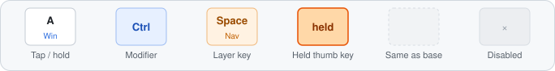
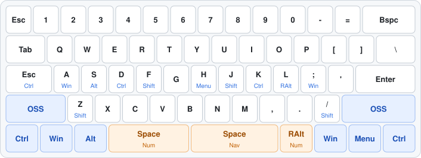
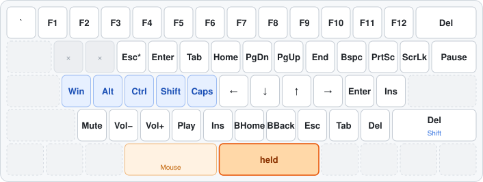
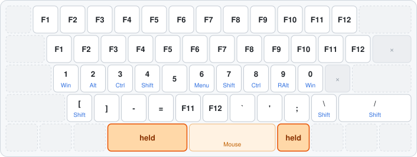
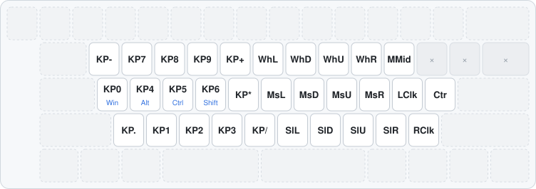

# 30-60% Kanata Layout

One layout for every keyboard.

A [kanata](https://github.com/jtroo/kanata) configuration ([`kanata.kbd`](kanata.kbd)) that gives you **the same layout on every keyboard and every operating system**: full size, 60%, 40% and 30% (split) keyboards, on Windows, Linux and macOS, with no changes to the file.

## Contents

- [Goals](#goals)
- [How it works](#how-it-works)
- [Installing kanata](#installing-kanata)
- [Running the configuration](#running-the-configuration)
- [Reading the layer diagrams](#reading-the-layer-diagrams)
- [The base layer](#the-base-layer)
- [Thumb keys and layer switching](#thumb-keys-and-layer-switching)
- [Nav layer](#nav-layer)
- [Num layer](#num-layer)
- [Mouse layer](#mouse-layer)
- [Chords (combos)](#chords-combos)
- [Timing and anti-misfire settings](#timing-and-anti-misfire-settings)
- [Adapting the layout](#adapting-the-layout)
- [Regenerating the diagrams](#regenerating-the-diagrams)
- [References](#references)

---

## Goals

If you switch between a laptop keyboard and one or more mechanical keyboards, or between computers running different operating systems, every setup probably behaves differently. Arrows, F-keys, the number row or even the Shift keys may be missing, and every OS has its own remapping tools. Learning a separate layout for each combination is slow and frustrating.

This configuration solves that by:

1. **Keeping everything within reach of the home row.** Navigation, F-keys, numbers, symbols, media keys and even the mouse are available on layers activated with your thumbs, so they work on boards that physically lack those keys.
2. **Working the same on every keyboard size.** The file is written for a 60% layout. Smaller boards use the layers for the keys they lack. Larger boards keep their extra keys (arrows, F-keys, numpad) working normally, while the layers are still there when you want them.
3. **Working the same on every operating system.** kanata runs on Windows, Linux and macOS and reads the same configuration file on each, so one file gives you one layout everywhere.
4. **Replacing hard-to-reach keys.** Modifiers move to the home row, Shift is available on letters for boards without Shift keys, and common symbols can be typed with two-key chords.
5. **Avoiding misfires while typing.** Home row mods and chords only become active when you're not in the middle of a fast burst of typing.

Once your muscle memory is built for one keyboard, it works on all of them.

## How it works

kanata is a software keyboard remapper. It runs in the background, intercepts key presses from *any* connected keyboard and replaces them according to the configuration file. No keyboard firmware changes are needed.

- The `defsrc` block describes a **60% ANSI layout** plus two extra thumb keys, `F13` and `F14` (see [Split space bars](#split-space-bars)).
- `process-unmapped-keys yes` makes kanata handle keys outside the 60% area too, but without remapping them. On a full-size keyboard, the arrows, F-keys, numpad and navigation block keep working as usual.
- `delegate-to-first-layer yes` makes every transparent key (`_`) on a layer fall back to the **base layer**. For example, the special Shift keys work the same on every layer.

### Which keys each size is missing

| Board size  | Missing keys that this layout puts on layers                                           |
|-------------|----------------------------------------------------------------------------------------|
| 60%         | Esc, F1–F12, arrows, Ins/Del/Home/End/PgUp/PgDn, PrtSc/ScrLk/Pause, numpad, media keys |
| 40%         | All of the above, plus the number row, `` ` `` `-` `=` `\` and often `[ ] ; ' /`       |
| 30% (split) | All of the above, plus some symbols, separate Shift/Ctrl/Alt/Win keys, Tab/Caps/Enter  |
| Full size   | Nothing. Everything works natively *and* on the layers                                 |

On a 40% or 30% board, the physical keys that do exist send the same key codes as on a 60% board, so they land on the same positions in `defsrc`. Keys that don't exist are reached through layers and chords.

### Modifier names on each operating system

The configuration uses the same key codes on every OS. The operating system decides what they're called:

| In this README | Windows | Linux        | macOS         |
|----------------|---------|--------------|---------------|
| Win            | Windows | Super / Meta | Command (⌘)   |
| Alt            | Alt     | Alt          | Option (⌥)    |
| RAlt           | AltGr   | AltGr        | Right Option  |
| Ctrl           | Ctrl    | Ctrl         | Control (⌃)   |
| Menu           | Menu    | Menu         | (no function) |

---

## Installing kanata

> **Requires kanata 1.12 or newer.** The global `tap-hold-require-prior-idle` setting (and the per-key `require-prior-idle` exemption used on the space keys) only works from version 1.12. Older versions won't load this configuration.

Download the zip file for your system from the [kanata releases page](https://github.com/jtroo/kanata/releases), for example `windows-binaries-x64.zip`, `linux-binaries-x64.zip` or `macos-binaries-arm64.zip`. Pick `arm64` for ARM computers (such as Apple Silicon Macs) and `x64` for Intel/AMD.

This configuration **doesn't use `cmd` actions**, so you don't need the variants with `cmd_allowed` in the name. The standard variants (with `cmd` compiled out) are the safer choice.

### Where to put the files

Keep the kanata executable and `kanata.kbd` together in a folder of your own, for example:

| OS      | Suggested folder        |
|---------|-------------------------|
| Windows | `%USERPROFILE%\kanata\` |
| Linux   | `~/.config/kanata/`     |
| macOS   | `~/.config/kanata/`     |

You can also clone or download this repository and run kanata from its folder.

### Windows

The Windows zip contains several variants. Their names follow the pattern `kanata_windows_<interface>_<driver>[_cmd_allowed]_x64.exe`:

| Part         | Options                                                                                  |
|--------------|------------------------------------------------------------------------------------------|
| `tty`        | Runs in a terminal window, where kanata shows its log messages                           |
| `gui`        | Runs without a terminal window, as a **system tray application** with a kanata tray icon |
| `winIOv2`    | Uses standard Windows keyboard hooks. **No extra driver needed.** Recommended            |
| `wintercept` | Uses the Interception driver, which must be installed separately (see below)             |

The [Interception driver](https://github.com/oblitum/Interception) can work in situations where `winIOv2` doesn't, such as some games, but `winIOv2` is the simpler choice for most people.

Recommended:

- **`kanata_windows_gui_winIOv2_x64.exe`** if you want kanata to run quietly in the system tray.
- **`kanata_windows_tty_winIOv2_x64.exe`** if you want to see kanata's messages in a terminal, which is handy while you're adjusting the configuration.

To start kanata automatically when you log in, put a shortcut to the executable (with `--cfg` and the path to `kanata.kbd` as arguments) in your Startup folder. Press `Win+R` and type `shell:startup` to open it.

### Linux

1. Unzip `linux-binaries-x64.zip` and use `kanata_linux_x64`. You can also install kanata with `cargo install kanata` or from your distribution's package manager, if available.
2. kanata needs access to `/dev/input` and `/dev/uinput`. The usual setup is to add your user to the `input` and `uinput` groups and add a udev rule, so kanata doesn't need `sudo`. See the Linux instructions in the [kanata README](https://github.com/jtroo/kanata#readme).
3. Optional: run kanata as a systemd user service so it starts on login.

### macOS

1. Install the [Karabiner-DriverKit-VirtualHIDDevice](https://github.com/pqrs-org/Karabiner-DriverKit-VirtualHIDDevice) driver, which kanata needs on macOS. Use the driver version listed in the kanata release notes.
2. Unzip the macOS zip and use `kanata_macos_arm64` (Apple Silicon) or `kanata_macos_x64` (Intel). kanata must run with `sudo`.
3. Grant Input Monitoring and Accessibility permissions when macOS asks for them.

On all systems, [kanata-tray](https://github.com/rszyma/kanata-tray) is an optional tray app that can start, stop and switch kanata configurations. The kanata releases page and [README](https://github.com/jtroo/kanata#readme) have the full, up-to-date installation instructions for each platform.

## Running the configuration

Run these commands from the folder that contains kanata and `kanata.kbd`. Check the configuration for errors first, then start kanata.

**Windows:**

```bash
kanata_windows_tty_winIOv2_x64.exe --cfg kanata.kbd --check
```

```bash
kanata_windows_tty_winIOv2_x64.exe --cfg kanata.kbd
```

With the `gui` variant, start `kanata_windows_gui_winIOv2_x64.exe --cfg kanata.kbd` the same way. It appears as an icon in the system tray instead of a terminal window.

**Linux:**

```bash
./kanata_linux_x64 --cfg kanata.kbd --check
```

```bash
./kanata_linux_x64 --cfg kanata.kbd
```

**macOS:**

```bash
sudo ./kanata_macos_arm64 --cfg kanata.kbd --check
```

```bash
sudo ./kanata_macos_arm64 --cfg kanata.kbd
```

To stop kanata, close its window (or quit it from the tray icon), or press **Left Ctrl + Space + Esc**. That's kanata's built-in emergency exit, which uses the physical keys.

After editing `kanata.kbd`, you don't need to restart kanata. Hold **Space** for the nav layer and tap **E** four times to reload the configuration (see [Nav layer](#nav-layer)).

---

## Reading the layer diagrams

The diagrams below show the 60% key positions, with the thumb row at the bottom. Each key shows its **tap** action in large text and its **hold** action, where it has one, in small text underneath. The colours show what kind of key it is:



The diagrams follow your system's light or dark theme. Each one also has a **Text version** you can expand, which uses these symbols:

| Symbol | Meaning                                                  |
|--------|----------------------------------------------------------|
| `--`   | Transparent: behaves like the same key on the base layer |
| `XX`   | Disabled: does nothing on this layer                     |
| `held` | The thumb key you're holding to stay on this layer       |

Other abbreviations used in both versions:

| Label  | Meaning                                                        |
|--------|----------------------------------------------------------------|
| `OSS`  | One-shot Shift / Caps Word key (see [Shift keys](#shift-keys)) |
| `RAlt` | Right Alt (AltGr on international layouts)                     |

---

## The base layer



<details>
<summary>Text version</summary>

<!-- text:base -->
```
+-------+-------+-------+-------+-------+-------+-------+-------+-------+-------+-------+-------+-------+-------+
| Esc   | 1     | 2     | 3     | 4     | 5     | 6     | 7     | 8     | 9     | 0     | -     | =     | Bspc  |
|       |       |       |       |       |       |       |       |       |       |       |       |       |       |
+-------+-------+-------+-------+-------+-------+-------+-------+-------+-------+-------+-------+-------+-------+
| Tab   | Q     | W     | E     | R     | T     | Y     | U     | I     | O     | P     | [     | ]     | \     |
|       |       |       |       |       |       |       |       |       |       |       |       |       |       |
+-------+-------+-------+-------+-------+-------+-------+-------+-------+-------+-------+-------+-------+-------+
| Esc   | A     | S     | D     | F     | G     | H     | J     | K     | L     | ;     | '     | Enter |
| Ctrl  | Win   | Alt   | Ctrl  | Shift |       | Menu  | Shift | Ctrl  | RAlt  | Win   |       |       |
+-------+-------+-------+-------+-------+-------+-------+-------+-------+-------+-------+-------+-------+
| OSS   | Z     | X     | C     | V     | B     | N     | M     | ,     | .     | /     | OSS   |
|       | Shift |       |       |       |       |       |       |       |       | Shift |       |
+-------+-------+-------+-------+-------+-------+-------+-------+-------+-------+-------+-------+
| Ctrl  | Win   | Alt   | Space |       | Space | RAlt  | Win   | Menu  | Ctrl  |
|       |       |       | Num   | Mouse | Nav   | Num   |       |       |       |
+-------+-------+-------+-------+-------+-------+-------+-------+-------+-------+
```
<!-- /text:base -->

</details>

The base layer is a normal QWERTY layout with these changes:

### Esc on the top-left key

The key left of `1` (normally `` ` ``) sends **Esc**, where most keyboards without a function row expect it. The backtick is still available on the nav and num layers and through the `M` + `,` chord.

### Caps Lock: Esc / Ctrl

- **Tap:** Esc
- **Hold:** Ctrl

This uses `tap-hold-press`: as soon as you press another key while holding Caps Lock, it acts as Ctrl, so shortcuts like `Ctrl+C` feel immediate. Caps Lock itself is on the nav layer (`G`).

### Home row mods

The home row keys act as modifiers when held, so you never have to leave the home row for shortcuts:

| Key  | `A` | `S` | `D`  | `F`   | `H`  | `J`   | `K`  | `L`  | `;` |
|------|-----|-----|------|-------|------|-------|------|------|-----|
| Tap  | a   | s   | d    | f     | h    | j     | k    | l    | ;   |
| Hold | Win | Alt | Ctrl | Shift | Menu | Shift | Ctrl | RAlt | Win |

The modifiers are placed so that **the strongest fingers have direct access to the most-used modifiers**:

- **Index fingers (`F`, `J`): Shift.** Shift is by far the most-used modifier, and the index finger is the strongest and most agile finger.
- **Middle fingers (`D`, `K`): Ctrl.** Ctrl is used for most shortcuts (copy, paste, undo, save) and gets the next strongest finger.
- **Ring fingers (`S`, `L`): Alt.**
- **Pinkies (`A`, `;`): Win**, the least-used modifier, on the weakest finger.

The order is mirrored on both hands, so you can always hold a modifier with one hand and press the key with the other. The same modifiers are on the number keys in the [num layer](#num-layer), on the keypad digits in the [mouse layer](#mouse-layer), and as plain modifiers in the [nav layer](#nav-layer).

`H` (an inward stretch for the right index finger) gives the **Menu** (context menu / Application) key, which most compact boards lack.

### Shift keys

Both Shift keys (`OSS`) work as:

- **Tap:** one-shot Shift. The next key you press is shifted, without holding anything. It cancels after 2 seconds if you don't press a key.
- **Double tap:** Caps Word. Letters are typed in capitals until you type a space or punctuation (or 2 seconds pass without typing). Useful for `CONSTANT_NAMES`.

### Alpha Shift: Shift on Z and /

30% boards often have no Shift keys, so **`Z`** and **`/`** (the outer keys of the bottom row) double as Shift:

| Action           | Result                                 |
|------------------|----------------------------------------|
| Tap              | `z` (or `/`)                           |
| Hold + other key | Shift is held, like a normal Shift key |
| Hold and release | One-shot Shift for the next key        |
| Double tap       | `zz` (or `//`)                         |
| Tap, then hold   | Caps Word                              |

The same behaviour is on `[` and `\` in the num layer and `Del` in the nav layer, so there's always a Shift on the outer bottom keys.

---

## Thumb keys and layer switching

The layers are opened with the thumb keys: the left space key (`F13`), the middle thumb key (`F14`), the normal space bar and Right Alt (see the bottom row of the [base layer](#the-base-layer) diagram). Each space key does several things depending on how you tap or hold it:

| Action              | Right space (normal space bar) | Left space (F13) | Right Alt        |
|---------------------|--------------------------------|------------------|------------------|
| Tap                 | Space                          | Space            | Right Alt        |
| Hold                | **Nav** layer                  | **Num** layer    | **Num** layer    |
| Tap, then hold      | **Num** layer                  | **Nav** layer    | Right Alt (held) |
| Tap, tap, then hold | **Mouse** layer                | **Mouse** layer  | n/a              |
| Double tap          | Two spaces                     | Two spaces       | n/a              |
| Triple tap          | Three spaces                   | Three spaces     | n/a              |

There are more ways to reach the mouse layer:

- **Middle thumb key (F14):** hold for the **mouse** layer. Tapping it does nothing, so it never sends `F14` to your applications.
- **Both space keys:** hold one space key for nav or num, then hold the other to switch to the **mouse** layer.

The layers are only active while you hold the key (`layer-toggle`), so you never get stuck on one.

### On a keyboard with a normal space bar

Most keyboards (including full-size boards and laptops) have a single space bar, which is the **right space** column in the table. You'll mainly use:

- **Hold Space** for nav
- **Hold Right Alt** or **tap-then-hold Space** for num
- **Tap-tap-hold Space** for mouse

### Split space bars

`F13` and `F14` are used for the extra thumb keys because **almost no physical keyboard has them**, so they never clash with keys you already use. On keyboards with a split space bar or several thumb keys, program the extra keys in the keyboard firmware (for example with QMK or VIA) to send:

- **F13** for the left space key
- **F14** for the middle key
- **Space** for the right space key

kanata then maps them to the functions above. On keyboards that don't send F13 or F14, those functions are simply not used and nothing breaks.

---

## Nav layer

**Activate:** hold right Space, or tap-then-hold left Space (F13).



<details>
<summary>Text version</summary>

<!-- text:nav -->
```
+-------+-------+-------+-------+-------+-------+-------+-------+-------+-------+-------+-------+-------+-------+
| `     | F1    | F2    | F3    | F4    | F5    | F6    | F7    | F8    | F9    | F10   | F11   | F12   | Del   |
|       |       |       |       |       |       |       |       |       |       |       |       |       |       |
+-------+-------+-------+-------+-------+-------+-------+-------+-------+-------+-------+-------+-------+-------+
| --    | XX    | XX    | Esc*  | Enter | Tab   | Home  | PgDn  | PgUp  | End   | Bspc  | PrtSc | ScrLk | Pause |
|       |       |       |       |       |       |       |       |       |       |       |       |       |       |
+-------+-------+-------+-------+-------+-------+-------+-------+-------+-------+-------+-------+-------+-------+
| --    | Win   | Alt   | Ctrl  | Shift | Caps  | Left  | Down  | Up    | Right | Enter | Ins   | --    |
|       |       |       |       |       |       |       |       |       |       |       |       |       |
+-------+-------+-------+-------+-------+-------+-------+-------+-------+-------+-------+-------+-------+
| --    | Mute  | Vol-  | Vol+  | Play  | Ins   | BHome | BBack | Esc   | Tab   | Del   | Del   |
|       |       |       |       |       |       |       |       |       |       |       | Shift |
+-------+-------+-------+-------+-------+-------+-------+-------+-------+-------+-------+-------+
| --    | --    | --    |       | XX    | held  | --    | --    | --    | --    |
|       |       |       | Mouse |       |       |       |       |       |       |
+-------+-------+-------+-------+-------+-------+-------+-------+-------+-------+
```
<!-- /text:nav -->

</details>

This layer is about navigation and editing, with everything a 60% board is missing:

- **Arrows** on `H J K L` (Vim style), **Home / PgDn / PgUp / End** on `Y U I O`.
- **Plain modifiers** on `A S D F` (Win, Alt, Ctrl, Shift). Hold them together with the arrows for word jumps (`Ctrl+Left`), selections (`Shift+Down`) and so on, all from the home row.
- **Editing keys** close to the home row: Enter (`R`, `;`), Tab (`T`, `.`), Backspace (`P`), Delete (`/`, Backspace position), Insert (`B`, `'`) and Esc (`,`).
- **Caps Lock** on `G`.
- **F1–F12** on the number row, and `` ` `` on the top-left key.
- **Media keys** on the bottom-left: Mute, Volume down, Volume up, Play/Pause.
- **Browser keys:** Browser Home (`N`, BHome) and Browser Back (`M`, BBack).
- **PrtSc, ScrLk, Pause** on `[ ] \`.
- The right Shift position gives **Del** with [Alpha Shift](#alpha-shift-shift-on-z-and-) behaviour.
- `Q` and `W` are disabled to avoid accidental input.
- Holding the **left space key (F13)** while in this layer switches to the **mouse** layer. The F14 key is disabled here.

### Esc and live reload (`E`)

`Esc*` on `E` is a tap dance:

| Taps | Result                              |
|------|-------------------------------------|
| 1    | Esc                                 |
| 2    | Esc Esc                             |
| 3    | Esc Esc Esc                         |
| 4    | **Reload** the kanata configuration |

That makes it easy to try out changes to `kanata.kbd` without restarting kanata.

---

## Num layer

**Activate:** hold left Space (F13), hold Right Alt, or tap-then-hold right Space.



<details>
<summary>Text version</summary>

<!-- text:num -->
```
+-------+-------+-------+-------+-------+-------+-------+-------+-------+-------+-------+-------+-------+-------+
| --    | F1    | F2    | F3    | F4    | F5    | F6    | F7    | F8    | F9    | F10   | F11   | F12   | --    |
|       |       |       |       |       |       |       |       |       |       |       |       |       |       |
+-------+-------+-------+-------+-------+-------+-------+-------+-------+-------+-------+-------+-------+-------+
| --    | F1    | F2    | F3    | F4    | F5    | F6    | F7    | F8    | F9    | F10   | F11   | F12   | XX    |
|       |       |       |       |       |       |       |       |       |       |       |       |       |       |
+-------+-------+-------+-------+-------+-------+-------+-------+-------+-------+-------+-------+-------+-------+
| --    | 1     | 2     | 3     | 4     | 5     | 6     | 7     | 8     | 9     | 0     | XX    | --    |
|       | Win   | Alt   | Ctrl  | Shift |       | Menu  | Shift | Ctrl  | RAlt  | Win   |       |       |
+-------+-------+-------+-------+-------+-------+-------+-------+-------+-------+-------+-------+-------+
| --    | [     | ]     | -     | =     | F11   | F12   | `     | '     | ;     | \     | /     |
|       | Shift |       |       |       |       |       |       |       |       | Shift | Shift |
+-------+-------+-------+-------+-------+-------+-------+-------+-------+-------+-------+-------+
| --    | --    | --    | held  | --    |       | held  | --    | --    | --    |
|       |       |       |       |       | Mouse |       |       |       |       |
+-------+-------+-------+-------+-------+-------+-------+-------+-------+-------+
```
<!-- /text:num -->

</details>

This layer brings the number row and missing symbols to the alpha keys:

- **Numbers 1–0 on the home row**, with the same [home row mods](#home-row-mods) as the letters (5 has no modifier, like `G`).
- **F1–F12 on the top alpha row.** They're also on the number row, but **the duplication is intentional**: 40% and 30% boards have no number row, so the top alpha row is the only place they can be.
- **Symbols on the bottom row**: `[` `]` `-` `=` `` ` `` `'` `;` `\` `/`. On a 30% board these are often missing. Combined with Shift they also give `{ } _ + ~ " : | ?`.
- `[`, `\` and `/` have [Alpha Shift](#alpha-shift-shift-on-z-and-) behaviour, so Shift is always available on the outer bottom keys.
- Holding the **right space key** while in this layer switches to the **mouse** layer.

---

## Mouse layer

**Activate:** hold the middle thumb key (F14), tap-tap-hold either space key, or hold both space keys.



<details>
<summary>Text version</summary>

<!-- text:mouse -->
```
+-------+-------+-------+-------+-------+-------+-------+-------+-------+-------+-------+-------+-------+-------+
| --    | --    | --    | --    | --    | --    | --    | --    | --    | --    | --    | --    | --    | --    |
|       |       |       |       |       |       |       |       |       |       |       |       |       |       |
+-------+-------+-------+-------+-------+-------+-------+-------+-------+-------+-------+-------+-------+-------+
| --    | KP-   | KP7   | KP8   | KP9   | KP+   | WhL   | WhD   | WhU   | WhR   | MMid  | XX    | XX    | XX    |
|       |       |       |       |       |       |       |       |       |       |       |       |       |       |
+-------+-------+-------+-------+-------+-------+-------+-------+-------+-------+-------+-------+-------+-------+
| --    | KP0   | KP4   | KP5   | KP6   | KP*   | MsL   | MsD   | MsU   | MsR   | LClk  | Ctr   | --    |
|       | Win   | Alt   | Ctrl  | Shift |       |       |       |       |       |       |       |       |
+-------+-------+-------+-------+-------+-------+-------+-------+-------+-------+-------+-------+-------+
| --    | KP.   | KP1   | KP2   | KP3   | KP/   | SlL   | SlD   | SlU   | SlR   | RClk  | --    |
|       |       |       |       |       |       |       |       |       |       |       |       |
+-------+-------+-------+-------+-------+-------+-------+-------+-------+-------+-------+-------+
| --    | --    | --    | --    | held  | --    | --    | --    | --    | --    |
|       |       |       |       |       |       |       |       |       |       |
+-------+-------+-------+-------+-------+-------+-------+-------+-------+-------+
```
<!-- /text:mouse -->

</details>

The left hand gets a **numpad**, the right hand controls the **mouse**:

| Keys        | Function                                                                      |
|-------------|-------------------------------------------------------------------------------|
| `Q W E R T` | Keypad `-` `7` `8` `9` `+`                                                    |
| `A S D F G` | Keypad `0` `4` `5` `6` `*` (0/4/5/6 have Win/Alt/Ctrl/Shift on hold)          |
| `Z X C V B` | Keypad `.` `1` `2` `3` `/`                                                    |
| `Y U I O`   | Scroll wheel left / down / up / right (WhL–WhR, accelerates while held)       |
| `H J K L`   | Move pointer left / down / up / right (MsL–MsR, accelerates while held)       |
| `N M , .`   | Move pointer slowly left / down / up / right (SlL–SlR), for precise placement |
| `P` `;` `/` | Middle click, left click, right click                                         |
| `'` (Ctr)   | Move the pointer to exactly the centre of the screen                          |

The numpad sends real keypad codes (`KP…`), which apps such as spreadsheets and calculators treat as numpad input. On Windows, the keypad digits only type numbers when **Num Lock** is on.

---

## Chords (combos)

Pressing two neighbouring keys **at the same time** (within 20 ms) on the base layer types a symbol. That puts the most-used programming symbols right on the alpha keys. Each purple symbol is typed by pressing the two keys on either side of it:

![Chords: { [ ( < > ) ] } on the top row, ! @ # $ % ^ & * € on the home row, ? - = ; ` ' \ on the bottom row](images/chords.svg)

<details>
<summary>Text version</summary>

```
  Q   W   E   R   T   Y   U   I   O   P
    {   [   (   <       >   )   ]   }

  A   S   D   F   G   H   J   K   L   ;
    !   @   #   $   %   ^   &   *   €

  Z   X   C   V   B   N   M   ,   .   /
    ?   -   =           ;   `   '   \
```

</details>

The layout is designed to be easy to remember:

- **Top row:** brackets that mirror around the middle: `{ [ ( <` on the left hand, `> ) ] }` on the right.
- **Home row:** the shifted number-row symbols `! @ # $ % ^ & *` in their usual order, plus `€`.
- **Bottom row:** `? - =` on the left, `` ; ` ' \ `` on the right.

Notes:

- Chords only work on the **base layer**, so they never get in the way on the nav, num and mouse layers.
- Chords only fire after a **short pause in typing** (no key pressed in the previous 500 ms, set with `chords-v2-min-idle`). This prevents misfires when you roll over two keys while typing fast, but it means you need a short pause before a chord.
- The symbols assume a **US QWERTY** keyboard layout in your operating system.
- `€` is typed with `unicode`, which doesn't work on Linux.

---

## Timing and anti-misfire settings

All timings are set as variables in the `defvar` block, so you can tune them in one place:

| Variable | Default | Meaning                                                               |
|----------|---------|-----------------------------------------------------------------------|
| `tt`     | 180 ms  | Tap time: window for tap dances and repeated taps                     |
| `ht`     | 180 ms  | Hold time: how long to hold a key before it acts as its hold function |
| `htq`    | 100 ms  | Quick hold time used for the space keys, so the layers open quickly   |
| `ct`     | 20 ms   | How close together two keys must be pressed to count as a chord       |
| `cancel` | 2000 ms | Timeout for one-shot Shift and Caps Word                              |

There are also variables to tune the mouse wheel speed (`mw-initial-v`, `mw-maximum-v`, `mw-accel`, `mw-decel`).

Two global settings in `defcfg` reduce misfires while typing:

- `tap-hold-require-prior-idle 150`: a key only acts as its hold function (such as a home row mod) if no other key was pressed in the previous 150 ms. While you're typing fast, home row keys simply type letters. The space keys are exempt (`require-prior-idle 0`), so the layers are always available. This setting requires kanata 1.12 or newer.
- `chords-v2-min-idle 500`: chords only fire after 500 ms without other key presses (see [Chords](#chords-combos)).

---

## Adapting the layout

The configuration is meant to be adapted to your own needs. Some suggestions:

- **Tune the timings first.** If home row mods trigger by accident, increase `ht`. If layers feel slow, decrease `htq`. If chords are hard to hit, increase `ct`. If you'd like to use chords mid-word (for example `foo(`), lower `chords-v2-min-idle` to around 150–250 ms.
- **Change the home row mod order.** Swap the modifiers in the `a`–`;` aliases (and the `1`–`0` and `kp` aliases to match) if you prefer, for example, Ctrl on the index finger. On macOS you might prefer Command (`lmet`) on a stronger finger, because it's used for most shortcuts there.
- **Use plain Shift on Z and /.** If you don't need one-shot Shift and Caps Word on these keys, the commented-out "Plain Alpha Shift" aliases are simpler alternatives.
- **Enter on `;` for very narrow boards.** On 40% boards without an Enter key, enable the commented-out `;` alias that sends Enter on tap.
- **AltGr layouts on Windows.** If you use an international layout with AltGr, enable the `windows-altgr` options in `defcfg` so Right Alt doesn't leave a stuck Ctrl.
- **Different OS keyboard layout.** The chords and symbols assume US QWERTY. For another layout (for example German or French), change the chord outputs to the keys that produce the symbols in your layout.
- **ISO keyboards.** ISO boards have an extra key next to Left Shift (`102d` in kanata). Add it to `defsrc` and to every layer if you want to use it.
- **Allow chords on all layers.** Edit the `chord-disabled` variable, for example `(mouse)`, to allow chords on the nav and num layers.
- **Replace the € chord** on Linux, or with a character you use more often.
- **Add your own layers.** The `NOTES` block at the end of `kanata.kbd` contains an empty 60% layer template. Copy it out of the comment block, rename it, fill in the keys, and activate it from a free key with `(layer-toggle name)`.
- **Use the unused mouse speed alias.** The `fst` alias (`movemouse-speed 300`) is defined but not mapped. Place it on a free key in the mouse layer to get a "fast mouse" modifier.

After each change, run kanata with `--check`, or press nav + `E` four times to reload.

---

## Regenerating the diagrams

The images in [`images/`](images) and the text version under each layer diagram are generated from `kanata.kbd`, so you don't have to redraw them by hand. Two equivalent scripts are included:

- [`tools/make-images.sh`](tools/make-images.sh) — bash and POSIX `awk`, for Linux and macOS.
- [`tools/make-images.ps1`](tools/make-images.ps1) — PowerShell, for Windows (or `pwsh` anywhere).

Run either one from anywhere; paths are resolved relative to the script:

```bash
bash tools/make-images.sh
pwsh -File tools/make-images.ps1
```

Both read `defsrc`, `deflayer`, `defalias`, `deftemplate` and `defchordsv2` from `kanata.kbd`, and produce byte-identical output:

- `images/layer-base.svg`, `layer-nav.svg`, `layer-num.svg`, `layer-mouse.svg` — one per layer, light and dark theme
- `images/chords.svg` and `images/legend.svg`
- the ASCII text versions in this README, between the `<!-- text:<layer> -->` and `<!-- /text:<layer> -->` markers

The options match: `-c`, `-o` and `-r` (bash) / `-Config`, `-OutDir` and `-Readme` (PowerShell) select a different config, output folder or README.

Anything the scripts don't recognise is drawn with its raw name and a warning, and a layer with the wrong number of keys for the physical layout is reported — which catches most copy-paste slips in a new layer. Two things are deliberately part of the scripts rather than the configuration: the physical key widths of each row, and the friendly labels for key names and actions. Extend those when you add something new.

---

## References

- [kanata project page](https://github.com/jtroo/kanata)
- [kanata releases](https://github.com/jtroo/kanata/releases)
- [kanata configuration guide](https://github.com/jtroo/kanata/blob/main/docs/config.adoc)
- [kanata key names](https://github.com/jtroo/kanata/blob/main/parser/src/keys/mod.rs)
- [kanata-tray](https://github.com/rszyma/kanata-tray)
